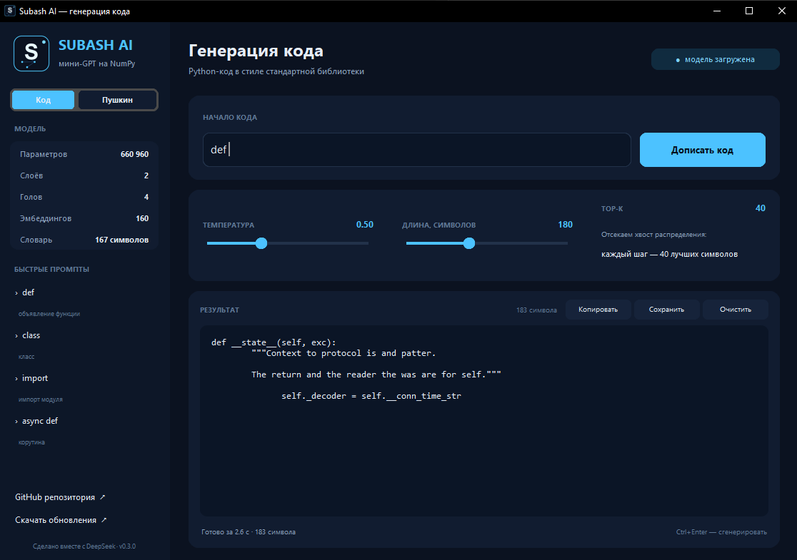
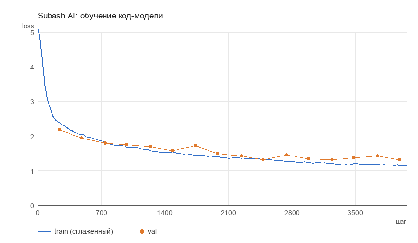

# Subash AI


[](https://github.com/nikitawcnu-bit/subash-ai/actions)


**Своя нейросеть на Python с нуля** — без PyTorch, TensorFlow и JAX. Только NumPy,
чистая математика и понятный код: движок автоматического дифференцирования, слои,
оптимизаторы, MLP и два мини-GPT — **код-модель** на 660 960 параметров и
литературная модель на сказках Пушкина. В приложении есть переключатель между ними.

> **Как создавался проект.** Subash AI сделан в паре с AI-ассистентом
> [DeepSeek](https://www.deepseek.com/): постановка задач и приёмка результата — за
> автором, код, обучение моделей и документация — за ассистентом. Ни одной строки
> PyTorch: только NumPy и математика.

```
Subash/
├── subash/            # сама библиотека (~1000 строк)
│   ├── tensor.py      # autograd: Tensor, операции, backward, softmax, cross-entropy
│   ├── nn.py          # Module, Linear, Embedding, LayerNorm, Dropout, активации
│   ├── models.py      # MLP и TinyGPT (multi-head causal attention)
│   ├── optim.py       # SGD с моментом, AdamW, clip_grad_norm, cosine_lr
│   ├── data.py        # char-level токенизатор, батчи, спираль/XOR/луны
│   ├── checkpoint.py  # сохранение/загрузка модели в один .npz
│   └── utils.py       # сид, подсчёт параметров, таймер
├── examples/          # обучение и генерация из консоли
├── app/               # GUI на customtkinter и сборка .exe
├── installer/         # NSIS-скрипт и сборка установщика
├── assets/            # иконка, скриншоты, графики
├── tests/             # 45 тестов, включая численную проверку градиентов
├── scripts/           # сборка корпусов, иконки, баннеров и графиков
└── data/
    ├── code.txt       # корпус Python-кода: stdlib + проект, 1.5 млн символов
    └── pushkin.txt    # 5 сказок А. С. Пушкина, 53 609 символов
```

## Быстрый старт

Нужен Python 3.10+ и NumPy.

```bash
pip install -r requirements.txt

# 1) обучить MLP на спирали (~7 секунд, точность ~97%)
python examples/train_mlp.py

# 2) обучить код-модель на Python-коде (~50 минут на CPU, 660 960 параметров)
python examples/train_code.py

# 2b) обучить литературную модель на сказках (~16 минут)
python examples/train_gpt.py

# 3) сгенерировать код или текст
python examples/generate.py --model code --prompt "def " --tokens 200
python examples/generate.py --model pushkin --prompt "Три девицы под окном"

# 4) интерактивный режим
python examples/chat.py

# тесты
python -m unittest discover -s tests
```

## Приложение для Windows

Два варианта, оба лежат в [Releases](https://github.com/nikitawcnu-bit/subash-ai/releases/latest):

- **Установщик** `SubashAI-Setup-0.3.0.exe` (~32 МБ) — ярлык в меню «Пуск»,
  деинсталлятор и запись в «Программы и компоненты». Ставится в профиль
  пользователя (`%LOCALAPPDATA%\Programs\Subash AI`), права администратора не нужны.
- **Портативный** `SubashAI.exe` (~32 МБ) — просто запустить, ничего не устанавливается.

Python не нужен: внутри интерпретатор, NumPy, customtkinter и веса модели.



Собрать самому:

```powershell
pip install -r requirements.txt pyinstaller
powershell -ExecutionPolicy Bypass -File app\build_exe.ps1
powershell -ExecutionPolicy Bypass -File installer\build_setup.ps1
```

Первый скрипт собирает exe, второй — установщик (NSIS скачается автоматически).
Windows может показать SmartScreen, потому что файлы не подписаны:
**Подробнее → Выполнить всё равно**.

## Результаты

**MLP на спирали** (2 → 128 → 128 → 3, 17 283 параметра, 3000 шагов, ~7 с на CPU):
точность на отложенной выборке **97%**. Точки — данные, фон — предсказание сети:


**Код-модель** (2 слоя, 4 головы, 160 эмбеддингов, **660 960 параметров**, 4000 шагов,
~50 минут на CPU): val loss **1.32**, perplexity **3.7**. Обучена только на Python-коде
(1.5 млн символов: стандартная библиотека и исходники проекта), без сказок.

Пример генерации (temperature 0.45, top-k 20, промпт `def `):

```python
def __init__(self, protocol):
    if self.__name__:
        return self.__name__
```

Модель выучила синтаксис, отступы, `self`, `__init__`, `if`, `return` и типичные
имена, но это не coding assistant: имена и логика остаются случайными, рабочий код
она не гарантирует. Больше примеров — в `checkpoints/samples_code.txt`.



**Литературная модель** (2 слоя, 4 головы, 96 эмбеддингов, 237 408 параметров, 1800 шагов,
~16 минут на CPU): финальный val loss **2.69** (perplexity 14.7), лучший val loss
**2.47** на 450-м шаге — дальше модель переобучается, потому что корпус маленький.

Пример генерации (temperature 0.6, top-k 20, промпт «Князь у синя моря ходит»):

```
Князь у синя моря ходит,
А видит опит вестает,
Судно весело бежит
Мимо острова Буяна,
В царст
```

Модель выучила ритм, пунктуацию, частые слова и целые куски («Судно весело бежит»,
«Мимо острова Буяна»), но на 53 тысячах символов смысл не держится. Это ожидаемо:
для связного текста нужен корпус в десятки мегабайт и модель побольше.


Больше примеров с разных шагов — в `checkpoints/samples.txt` (создаётся при обучении).

## Как это работает

### 1. Autograd

`Tensor` хранит массив NumPy, градиент и ссылки на родителей. Каждая операция
создаёт новый узел и функцию обратного распространения; `backward()` обходит граф
в обратном топологическом порядке.

```python
from subash import Tensor

x = Tensor([[1.0, 2.0]], requires_grad=True)
w = Tensor([[0.5], [-1.0]], requires_grad=True)

loss = ((x @ w) ** 2).sum()
loss.backward()

print(x.grad)   # [[-1.5  3. ]]
print(w.grad)   # [[-3.] [-6.]]
```

Поддерживаются broadcasting, batched `matmul`, срезы, `sum/mean`, `reshape`,
`transpose`, `exp/log/sqrt/tanh/sigmoid/relu`, `softmax` и fused `cross_entropy`
(softmax + NLL одним узлом, чтобы не терять точность). Режим `no_grad()`
отключает построение графа при генерации.

Корректность градиентов проверяется численно: в `tests/test_tensor.py` каждая
операция сравнивается с центральной конечной разностью (float64, точность 1e-5).

### 2. Слои и оптимизация

* `Linear` — инициализация He/Xavier, смещение;
* `Embedding` — таблица токенов, градиент собирается через `np.add.at`;
* `LayerNorm` — нормализация по последней оси;
* `Dropout` — переключается `model.train() / model.eval()`;
* `AdamW` — Adam с развязанным weight decay, `cosine_lr` с разогревом,
  обрезка нормы градиента.

### 3. Мини-GPT

Классический decoder-only трансформер:

```
токены → Embedding + позиции
       → [LayerNorm → Causal Self-Attention → +residual
          LayerNorm → MLP(GELU) → +residual] × N
       → LayerNorm → Linear → логиты по словарю
```

Причинная маска не даёт смотреть в будущее; веса выходного слоя связаны с
эмбеддингами (`weight tying`). Обучение — предсказание следующего символа,
loss — cross-entropy, генерация — сэмплирование с temperature / top-k / top-p.

Обе модели посимвольные: словарь 167 символов у код-модели и 77 у литературной.
Код-модель обучена на 1.5 млн символов Python (стандартная библиотека и исходники
проекта), литературная — на 53 тыс. символов сказок Пушкина.

## Обучение на своём тексте

Положите любой `.txt` в кодировке UTF-8 и запустите:

```bash
python examples/train_gpt.py --data my_text.txt --steps 3000 --n-embd 128 --n-layer 3

# продолжить обучение с сохранённых весов
python examples/train_gpt.py --init-from checkpoints/gpt_pushkin.npz --steps 800 --lr 1e-3
```

Словарь строится по символам автоматически и сохраняется вместе с весами.
Для корпуса побольше увеличьте `--n-embd`, `--n-layer` и `--steps`; на CPU это
линейно замедляет обучение.

Пересобрать корпуса:

```bash
python scripts/build_code_corpus.py   # Python stdlib + исходники проекта
python scripts/build_corpus.py        # сказки Пушкина (нужен bs4 и интернет)
```

Код-модель обучается через `examples/train_code.py` (660 960 параметров,
1.5 млн символов кода), литературная — через `examples/train_gpt.py`.

## Тесты

```bash
python -m unittest discover -s tests -v
```

45 тестов: численная проверка всех операций autograd, broadcasting и batched
matmul, сборка градиентов в embedding, режимы dropout, AdamW на квадратичной
функции, обучение XOR, переобучение крошечного GPT, round-trip чекпойнта.

## Ограничения

* Только CPU и NumPy: модели маленькие, это учебный проект, а не замена PyTorch.
* Код-модель (660 960 параметров, 1.5 млн символов) выучивает синтаксис, отступы и
  типичные конструкции, но не решает задачи и не гарантирует рабочий код.
* Литературная модель (53 тыс. символов) частично запоминает текст и иногда «плывёт».
* Токенизация посимвольная; для больших корпусов нужен BPE.
* Нет GPU, mixed precision и распределённого обучения.

## Планы

* BPE-токенизатор и корпус побольше;
* веб-интерфейс для генерации;
* профилирование и ускорение matmul;
* сохранение лучшего чекпойнта по val loss.

## Репозиторий

Обученные веса (`checkpoints/mlp_spiral.npz`, `checkpoints/gpt_code.npz` и
`checkpoints/gpt_pushkin.npz`, около 4 МБ) лежат в репозитории, поэтому после
клонирования генерация работает сразу, без обучения. Логи и кеши исключены через
`.gitignore`, а тесты автоматически запускаются в GitHub Actions
(`.github/workflows/tests.yml`).

## Данные и лицензия

Код-модель обучена на исходниках стандартной библиотеки Python 3.12
(лицензия PSF) и коде этого проекта. Тексты — сказки А. С. Пушкина с
[ru.wikisource.org](https://ru.wikisource.org), общественное достояние
(шаблон `PD-old`). Код проекта — MIT, см. [LICENSE](LICENSE).
